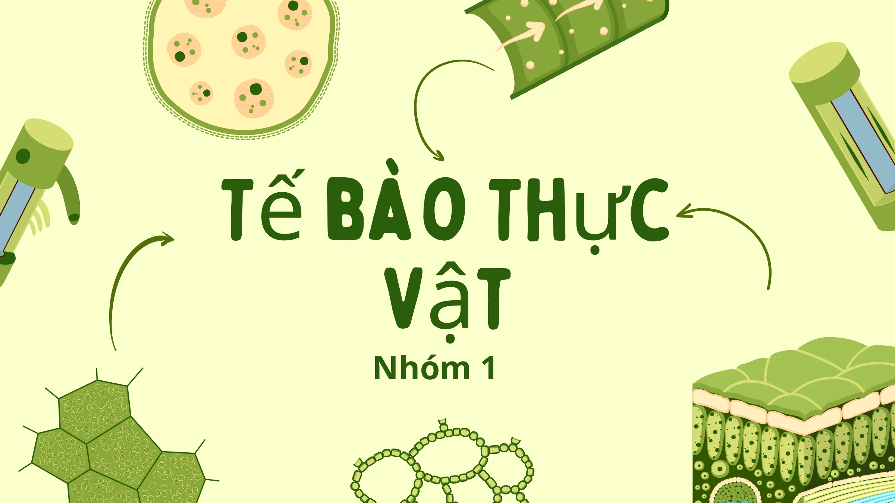

# 🌿 Tế Bào Thực Vật - Bài Thuyết Trình Sinh Học (Nhóm 1)

Ứng dụng web trình chiếu bài thuyết trình sinh học trực quan, tương tác cao về **Tế Bào Thực Vật** với tính năng quét mã QR để người xem / giáo viên theo dõi trực tiếp trên điện thoại di động trong thời gian thực.



## ✨ Tính Năng Nổi Bật

- **📱 Tương tác qua mã QR**: Người xem trong lớp hoặc giáo viên chỉ cần bật camera quét mã QR là bài thuyết trình tự động mở trên điện thoại (iOS / Android) mà không cần cài đặt ứng dụng.
- **🖼️ 18 Slide sắc nét 2K**: Được trích xuất trực tiếp từ file thiết kế PDF vector gốc ở độ phân giải 2400x1350 (WebP tối ưu hóa), giữ nguyên 100% hình minh họa và typography sinh học đáng yêu.
- **⚡ Tốc độ ánh sáng**: Toàn bộ ứng dụng cực nhẹ, tải dưới 1 giây, tự động nạp trước (preload) các slide kế tiếp để chuyển slide mượt mà 0ms độ trễ.
- **🖥️ Chế độ Trình Chiếu Chuyên Nghiệp**:
  - Phóng to Toàn màn hình (**F**)
  - Điều khiển linh hoạt: Phím mũi tên Trái/Phải, Phím Space, PageUp / PageDown, hoặc click 2 mép màn hình
  - Vuốt chạm (Swipe touch) mượt mà trên smartphone / máy tính bảng
  - Chế độ tự động phát (**A**)
- **🪟 Lưới Tổng Quan Slide (G)**: Nhảy nhanh tới bất kỳ trang nào trong 18 slide chỉ với một cú click.
- **📝 Ghi Chú & Nội Dung Bài Giảng (N)**: Hiển thị đầy đủ văn bản thuyết minh và kiến thức của từng bào quan để người thuyết trình tra cứu tức thì.
- **📄 Tải PDF Gốc**: Tích hợp nút tải trực tiếp file PDF gốc chất lượng cao cho bất kỳ ai muốn lưu tài liệu ôn tập.

---

## ⌨️ Phím Tắt Trình Chiếu

| Phím | Chức năng |
| :--- | :--- |
| `→` / `Space` / `PageDown` | Chuyển sang slide tiếp theo |
| `←` / `PageUp` | Quay lại slide trước đó |
| `F` | Bật / Tắt chế độ Toàn màn hình |
| `Q` | Mở cửa sổ Mã QR chia sẻ cho người xem |
| `G` | Mở lưới xem nhanh toàn bộ 18 slide |
| `N` | Mở ngăn nội dung / ghi chú bài thuyết trình |
| `A` | Bật / Tắt chế độ tự động chuyển slide (6 giây/trang) |
| `ESC` | Đóng các cửa sổ phụ |

---

## 🚀 Hướng Dẫn Triển Khai Lên Vercel

### Cách 1: Import trực tiếp từ GitHub vào Vercel (Khuyên dùng)
1. Đăng nhập vào [Vercel](https://vercel.com).
2. Nhấn **Add New...** > **Project**.
3. Chọn repository `khang224466/biology-presentation` (hoặc `te-bao-thuc-vat-slides`).
4. Vercel sẽ tự động phát hiện Framework: **Vite**, Output Directory: **dist**.
5. Nhấn **Deploy**. Sau ~20 giây, bạn sẽ nhận được đường link `https://<ten-du-an>.vercel.app`!
6. Khi mở web, bấm nút **Quét QR** trên góc phải để chiếu mã QR lên máy chiếu lớp học.

### Cách 2: Chạy cục bộ (Local Development)
```bash
pnpm install
pnpm dev
```
Mở trình duyệt tại `http://localhost:5173`.

---

## 👥 Nhóm Thực Hiện
- **Lớp**: Sinh học THPT / Đại học
- **Chủ đề**: Cấu trúc, đặc điểm và phân biệt tế bào thực vật & động vật
- **Tác quyền thiết kế**: Nhóm 1
